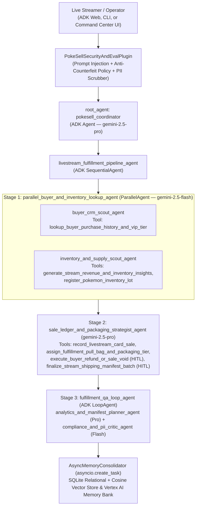

# PokeSell Ops (`pokesell-multi-agent`) — Pokémon TCG Live-Stream Sales, Repeat-Buyer CRM & Pull-Bag Fulfillment Multi-Agent System


---

## 1. Problem & Solution Statement

- **Problem**: Selling Pokémon TCG products live on **Whatnot** and **eBay Live**—across **Singles**, **Rip & Ship Booster Packs**, **Rip Till You Hit (RTYH)** breaks, **Graded Slabs (PSA/BGS/CGC)**, **Art Sleeves**, and **Metallic Coins**—becomes chaotic fast. Native stream dashboards lack historical cross-platform buyer CRM (*"Has `@pokefan99` bought from me before?"*), cannot track which physical binder slot or shelf a sold card lives in, fail to consolidate multiple same-stream auction wins into a single physical **Buyer Pull-Bag**, and obscure true net profit after Whatnot (`8% + 2.9% + $0.30`) vs. eBay (`13.25% + $0.40`) fees. Meanwhile, buyer shipping notes expose sensitive PII (emails, phone numbers, home street addresses).
- **Solution**: **PokeSell Ops** is a production-grade multi-agent application built with the **Google Agent Development Kit (ADK)** (`google-adk`), backed by a local **SQLite Relational + Vector Memory Ledger** and a hardened **FastAPI Live-Stream Command Center Web UI**. Tell your agent *"Sold Surging Sparks Rip Till You Hit (4 packs ripped, hit Pikachu SIR) to @pokefan99 on Whatnot for $68"* and it concurrently checks repeat-buyer VIP status, pulls the exact shelf/binder coordinate, auto-combines the win into `@pokefan99`'s open numbered **Pull-Bag (`BAG-002`)**, upgrades mailer protection (`PWE_ENVELOPE` -> `BUBBLE_MAILER_BMWT` -> `SLAB_RIGID_BOX` -> `INSURED_SIGNATURE_BOX`), scrubs buyer PII via **Google Cloud DLP + regex**, and enforces **Human-in-the-Loop (HITL)** confirmation before buyer refunds or carrier manifest closeouts.

---

## 2. Multi-Agent Architecture



---

## 3. Core Capabilities & Repository Map

| Area | Capability | Implementation in Repository |
| :--- | :--- | :--- |
| **Tool & Interface Design** | **Comprehensive Tool Docstrings** | [`pokesell_agent/tools.py`](pokesell_agent/tools.py): Exhaustive Google-style docstrings (`Purpose:`, `Args:`, `Returns:`) on all 7 domain tools documenting every parameter and output schema. |
| | **Descriptive Naming** | [`pokesell_agent/tools.py`](pokesell_agent/tools.py): Specific verb-noun domain identifiers (`record_livestream_card_sale`, `lookup_buyer_purchase_history_and_vip_tier`, `assign_fulfillment_pull_bag_and_packaging_tier`, `register_pokemon_inventory_lot`, `generate_stream_revenue_and_inventory_insights`, `execute_buyer_refund_or_sale_void`, `finalize_stream_shipping_manifest_batch`). |
| | **Explicit JSON Schemas** | [`pokesell_agent/schemas.py`](pokesell_agent/schemas.py): Strict Pydantic v2 `BaseModel` schemas (`ConfigDict(extra="forbid")`, `SellingFormat`, `MarketplacePlatform`, `GradingCompany`, `PackagingTier` enums) for all tool inputs and outputs, exported in `EXPLICIT_TOOL_JSON_SCHEMAS`. |
| | **Guided Error Handling** | [`pokesell_agent/schemas.py`](pokesell_agent/schemas.py) & [`pokesell_agent/tools.py`](pokesell_agent/tools.py): Tools catch schema, SKU-lookup, stock, and state errors and return `GuidedToolErrorResponse` with `recovery_instructions`, `suggested_next_tool`, and `suggested_parameters` so the LLM self-corrects without crashing. |
| **Context & Memory** | **Robust System Instructions** | [`pokesell_agent/prompts.py`](pokesell_agent/prompts.py): Multi-article `POKESELL_CONSTITUTION` defining Persona, Whatnot/eBay Fee Economics, Singles/Pack/RTYH/Slab/Sleeve/Coin Packaging Rules, Self-Correction, and Hard Safety/PII/HITL Constraints. |
| | **History Compaction** | [`pokesell_agent/memory.py`](pokesell_agent/memory.py) & [`pokesell_agent/guardrails.py`](pokesell_agent/guardrails.py): ADK `EventsCompactionConfig` (`LlmEventSummarizer`), `ContextCacheConfig`, `HistoryCompactor` token-budget sliding window with pinned constitutional anchors, and `compact_adk_llm_request`. |
| | **Persistent Session State** | [`pokesell_agent/database.py`](pokesell_agent/database.py) & [`pokesell_agent/memory.py`](pokesell_agent/memory.py): Persistent SQLite relational + sparse cosine vector store (`PokeSellLedgerDB` / `vector_memory_bank`), ADK `DatabaseSessionService` / `VertexAiSessionService`, `VertexAiMemoryBankService`, Vertex AI Search (`discoveryengine_v1`), plus `PreloadMemoryTool` & `LoadMemoryTool`. |
| | **Async Memory Operations** | [`pokesell_agent/memory.py`](pokesell_agent/memory.py): `AsyncMemoryConsolidator` and `async_after_agent_memory_callback` schedule PII scrubbing and vector indexing via `asyncio.create_task` without blocking UI responses. |
| **Orchestration & Logic** | **Multi-Agent Patterns** | [`pokesell_agent/agent.py`](pokesell_agent/agent.py): Combines ADK Coordinator `Agent` (`root_agent`), `ParallelAgent` (`parallel_buyer_and_inventory_lookup_agent`), `SequentialAgent` (`livestream_fulfillment_pipeline_agent`), and `LoopAgent` (`fulfillment_qa_loop_agent`). |
| | **Strategic Model Routing** | [`pokesell_agent/routing.py`](pokesell_agent/routing.py): `StrategicModelRouter` & `select_routed_model` route low-latency buyer CRM/stock triage to `gemini-2.5-flash` and multi-rule fulfillment/P&L planning to `gemini-2.5-pro`. |
| | **Guardrails & Policy Plugins** | [`pokesell_agent/guardrails.py`](pokesell_agent/guardrails.py): `PokeSellSecurityAndEvalPlugin(BasePlugin)` + `SelfEvaluationCritic` blocking prompt injections, counterfeit/proxy Pokémon card sales, fat-finger >$25k typos, and ungrounded or PII-leaking outputs. |
| | **Human-in-the-Loop Hooks** | [`pokesell_agent/tools.py`](pokesell_agent/tools.py) & [`pokesell_agent/guardrails.py`](pokesell_agent/guardrails.py): `FunctionTool(..., require_confirmation=True)` + `tool_context.request_confirmation()` inside `App(..., resumability_config=ResumabilityConfig(is_resumable=True))` + explicit `APPROVE-VOID-<SALE_ID>` / `APPROVE-MANIFEST-<STREAM_ID>` hard stops. |
| **Observability & Tracing** | **Structured JSON Logging** | [`pokesell_agent/observability.py`](pokesell_agent/observability.py): `StructuredJsonFormatter` (`python-json-logger` + `google-cloud-logging`) emitting structured JSON with `trace_id`, `span_id`, `correlation_id`, and `event_phase`—zero `print()` statements in agent library code. |
| | **Intent vs. Outcome Capture** | [`pokesell_agent/observability.py`](pokesell_agent/observability.py): `IntentOutcomeAuditLogger`, `@trace_and_audit_tool`, and ADK before/after callbacks explicitly log `event_phase="INTENT"` before execution and `event_phase="OUTCOME"` + `latency_ms` afterward. |
| | **Distributed Tracing** | [`pokesell_agent/observability.py`](pokesell_agent/observability.py): OpenTelemetry `TracerProvider` (`CloudTraceSpanExporter` + `InMemorySpanRecorder`) linking parent/child spans from `pokesell.query_to_answer` through sub-agents and SQLite tools. |
| | **PII Redaction** | [`pokesell_agent/pii_redaction.py`](pokesell_agent/pii_redaction.py): `PIIRedactionPipeline` actively scrubbing buyer emails, phones, street shipping addresses, SSNs, payment cards, and API tokens via regex + Google Cloud Sensitive Data Protection (`google.cloud.dlp_v2`). |
| **Infrastructure & CI/CD** | **Automated Evaluation Suites** | [`eval/golden_dataset.json`](eval/golden_dataset.json), [`eval/run_evaluation.py`](eval/run_evaluation.py), [`tests/test_agentops_rubric.py`](tests/test_agentops_rubric.py), and [`.github/workflows/agentops-ci.yml`](.github/workflows/agentops-ci.yml): 8-scenario golden regression harness + full pytest suite in GitHub Actions CI. |
| | **Infrastructure as Code** | [`terraform/main.tf`](terraform/main.tf), [`Dockerfile`](Dockerfile), [`agents-cli-manifest.yaml`](agents-cli-manifest.yaml), [`Makefile`](Makefile), and ADK / `agents-cli` workflows documented below. |
| | **Secure Secret Management** | [`pokesell_agent/secrets.py`](pokesell_agent/secrets.py): `SecretManagerService` dynamically retrieves secrets via Google Cloud Secret Manager (`google-cloud-secret-manager`) with zero hardcoded keys. |

---

## 4. Quickstart (Local SQLite Ledger + Command Center Web UI + ADK)

### 1. Install Dependencies

```bash
python3.12 -m venv .venv
source .venv/bin/activate
pip install -r requirements.txt
```

### 2. Launch the Live-Stream Command Center Web UI (`http://127.0.0.1:8080`)

```bash
make web
# Or directly:
python -m pokesell_agent.web_server
```

Open `http://127.0.0.1:8080` during your Whatnot or eBay stream to:
- Log **Singles, Rip & Ship Packs, Rip Till You Hit (RTYH), Graded Slabs, Art Sleeves, and Metallic Coins** in 1 click or via natural language.
- Watch open numbered **Buyer Pull-Bags (`BAG-001`, `BAG-002`...)** auto-combine repeat wins on your packing desk with exact binder/shelf pull coordinates and protection checklists.
- Track live **Gross vs. Whatnot/eBay Fee-Adjusted Net Profit** and approve HITL refunds or stream closeout manifests.

### 3. Run via Google ADK CLI & Terminal CLI

```bash
# Interactive ADK Web Playground
adk web .

# Interactive ADK Terminal Runner
adk run pokesell_agent

# One-shot or interactive PokeSell Streamer CLI
python -m pokesell_agent.cli "Sold PKM-151-CHARIZARD-SIR to @pokefan99 on whatnot for $155"
```

### 4. Run Unit Tests & Golden Dataset Evaluation Suite

```bash
# Run all 19-criterion AgentOps Rubric & Web BFF Security tests
pytest -v

# Run the 8-case Golden Dataset regression evaluation harness
python -m eval.run_evaluation
```

---

## 5. Google Cloud Deployment (`adk` CLI, `agents-cli` & Terraform IaC)

### Option A: Google Cloud `agents-cli` / `agent-starter-pack` Workflow

```bash
# Inspect manifest & launch ADK playground via agents-cli
agents-cli info
agents-cli playground

# Run evaluation suite against Golden Dataset
agents-cli eval pokesell_agent \
  --eval-dataset-path eval/golden_dataset.json \
  --config-path eval/eval_config.yaml

# Enhance CI/CD or deploy to Cloud Run / Vertex AI Agent Engine
agent-starter-pack enhance --cicd-runner github_actions
adk deploy cloud_run \
  --project="${GOOGLE_CLOUD_PROJECT}" \
  --region="us-central1" \
  --service_name="pokesell-multi-agent" \
  --with_ui \
  pokesell_agent
```

### Option B: Provision Production GCP Infrastructure via Terraform IaC

```bash
terraform -chdir=terraform init
terraform -chdir=terraform fmt -check
terraform -chdir=terraform validate
terraform -chdir=terraform plan -var="project_id=${GOOGLE_CLOUD_PROJECT}"
terraform -chdir=terraform apply -var="project_id=${GOOGLE_CLOUD_PROJECT}"
```
